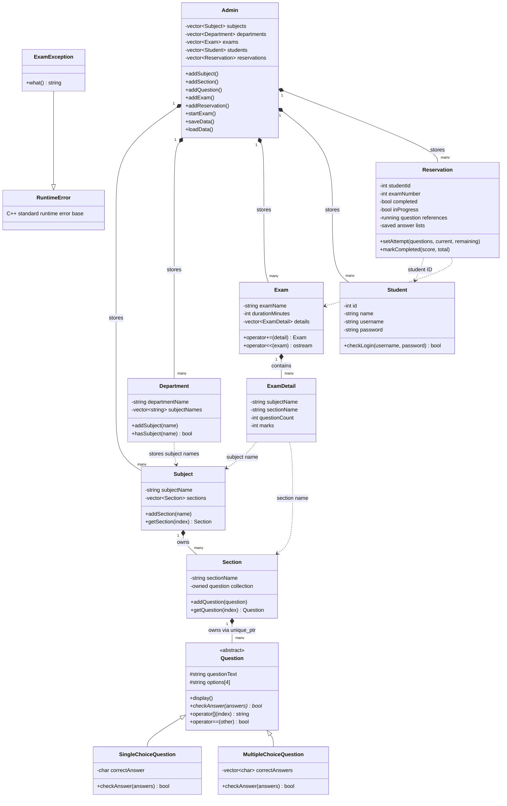

# Examination Management System

## Project idea

This is a C++17 console application for organizing subjects and their sections, building a multiple-choice question bank, creating examinations, reserving exams for students, and recording results. It demonstrates object-oriented programming by representing the main parts of the exam process as classes. Application data is stored in plain text files under `data/`, so it is available again the next time the program starts.

## Main features

- **Academic setup:** create departments and subjects, assign subjects to departments, and add sections to subjects.
- **Question bank:** add and display single-choice and multiple-choice questions within a section.
- **Exam setup:** create an exam by selecting one or more subject sections, the number of questions to draw from each, and the marks for each section.
- **Students and reservations:** add students, reserve exams, and view reservations. A student's username and password are checked before the student starts a reserved exam.
- **Quiz and exam taking:** randomly select the configured number of questions from each section. Navigate with `N` (next) and `P` (previous), change an answer by entering it again, `Q` to save and pause an exam, or `S` to submit.
- **Scoring:** single-choice and multiple-choice answers are graded by exact match. The exam reports section scores, an overall percentage, and pass/fail status. The passing threshold is 60%.
- **Resume and persistence:** a paused attempt stores the selected questions, answers, current position, and saved remaining time. Starting that reserved exam again resumes the attempt. Records are loaded at startup and saved when changed and on exit.

## Object-oriented design

- `Question` is an abstract base class. `SingleChoiceQuestion` and `MultipleChoiceQuestion` provide different answer checking through virtual functions.
- `Subject` owns sections, and each `Section` owns its questions through `unique_ptr`.
- `Exam` contains `ExamDetail` records that specify the subject, section, question count, and marks for each part of the exam.
- `Student`, `Reservation`, and `Department` model users, exam bookings, and department-subject assignments.
- The project uses STL containers such as `vector`, runtime polymorphism, exception handling, and file input/output. `Exam` overloads `+=` and `<<`; `Question` overloads `[]` and `==`.

## Class diagram

The diagram shows the current class structure. Filled diamonds indicate ownership: `Subject` contains its sections, `Section` owns its question objects, and `Exam` contains its details. `Admin` maintains the application collections. Reservations refer to students and exams by their stored IDs/numbers.



## Build and run

Use a C++17 compiler such as MinGW g++. Run the commands from the project root so the program can find its `data` directory.

### Windows PowerShell

```powershell
$sources = Get-ChildItem src -Filter *.cpp | ForEach-Object { $_.FullName }
g++ -std=c++17 -Wall -Wextra -Iinclude $sources -o ExaminationManagementSystem.exe
if ($LASTEXITCODE -eq 0) { .\ExaminationManagementSystem.exe }
```

### MSYS2 / MinGW shell

```bash
g++ -std=c++17 -Wall -Wextra -Iinclude src/*.cpp -o ExaminationManagementSystem.exe
./ExaminationManagementSystem.exe
```

Do not add `-pthread` for the current project. It does not use threads, and some MinGW distributions do not include the pthread library, which can cause a `cannot find -lpthread` linker error.

## Using the menu

Start by adding a department and a subject, then add a section to that subject. Add questions to the section before creating an exam that draws questions from it. Add a student and create a reservation for the exam. Choose **Start Exam** to sign in as that student and begin the reserved attempt. Use **Display Exam Results** to review completed results.

The menu also includes a standalone subject quiz. Enter a single letter such as `A` for single-choice questions. For multiple-choice questions, enter the selected letters separated by spaces, for example `A C`.

## Data files

The program stores its records in `data/`:

- `departments.txt`, `department_subjects.txt`
- `subjects.txt`, `sections.txt`, `questions.txt`
- `exams.txt`, `students.txt`, `reservations.txt`
- `exam_running.txt`, `exam_running_ans.txt`

Older question records that do not name a section are loaded into a section named `General`. The program writes section-aware question data when it saves.

## Current scope

This project uses the original name-based subject and sequential exam-number model. The broader workbook design described in the requirement document includes additional features such as separate administrator and student roles, exam codes and scheduled dates, and secure password hashing; those are not part of the current implementation.
